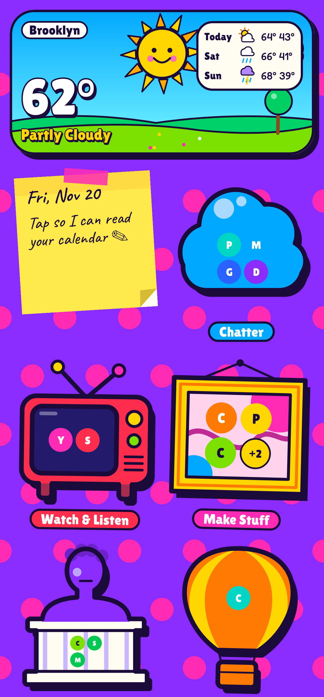

# Child's Play

A loud, toy-box Android launcher. The home screen is a collection of art and objects, called
**thing-widgets**. Each thing is a cloud, a TV, a painting, a statue, a balloon or a rocket, and
each one holds a group of apps. Tap a thing and its apps spring out of it in a pop-up panel.

This is a separate app from Searchlight and shares no code with it.



## What's in it

- **Thing-widgets.** You choose each thing's shape, colour, name and apps (long-press a thing,
  or use **+** in the dock). Things idle with a little bob, squish when you press them, and their
  panel springs open from the object. Long-press an app in a panel to take it out.
- **Toy Box (all apps).** A full A–Z app list with search. Long-press any app to put it into a
  thing, open App info, or uninstall it. Work-profile apps are included.
- **Rooms.** The ✱ button cycles loud backdrops: dots, stripes, confetti, checks, squiggles and
  zigzags.
- **Sticky note calendar (2×2).** Today's events from the phone's calendar provider, which is
  where Google Calendar syncs. It's yellow by default and written in Caveat handwriting, tilted
  and taped down. Tap it to open your calendar on today. Long-press it to change the note colour.
- **Hero Weather.** A separate launcher icon and a home widget. The screen is a living animated
  diorama (sun with a face, moon and stars, drifting clouds, rain, snow, lightning, fog, a
  swaying tree) with a giant temperature, a 48-hour strip, a 7-day view, details and six colour
  skins. The skin you pick changes both the app and its widget.
  - **Data:** Open-Meteo (no key). HRRR (`gfs_hrrr`) covers hours 0–48, current conditions and
    days 1–2. ECMWF IFS (`ecmwf_ifs025`) covers days 3–7 and fills any gaps HRRR leaves (HRRR is
    US-only). Every hour and day is labelled with the model it came from.
  - **Alerts:** NWS `api.weather.gov` active alerts for your point. Severe and Extreme alerts
    also show on the widget.
  - **Location:** coarse location, or a city picked by search (Open-Meteo geocoding). Units are
    °F/°C.

## Install the debug APK

```
./gradlew :app:assembleDebug
adb install -r app/build/outputs/apk/debug/app-debug.apk
```

Then press Home and pick **Child's Play** (or tap the yellow "Make Child's Play your home
screen" banner). The debug build's package is `com.childsplay.launcher.debug`.

Permissions it asks for: calendar (when you tap the sticky note) and approximate location (in
Hero Weather). Both are optional.

## Tests

```
./gradlew :app:testDebugUnitTest                          # weather merge, alerts, persistence
./gradlew :app:testDebugUnitTest -PscreenshotsDir=/tmp/s  # also render screens to PNG (Robolectric)
```

Requires JDK 17+ and Android SDK platform 35. Fonts: Lilita One, Fredoka and Caveat (SIL OFL;
licences in `licenses/`).
