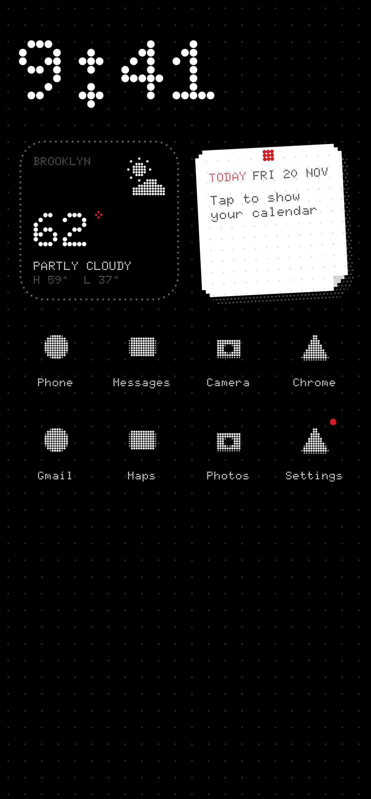

# Something

A minimal Android launcher in a Nothing-style dot-matrix language: black and white, one red
accent, dot-matrix type, pixel icons, and widgets framed in dots. Separate from Searchlight.



## Home

- **Structured 4-column grid** on a faint dot field, with generous spacing.
- **Clock:** a big dot-matrix clock with a red two-dot colon. Tap it for alarms.
- **Widgets (2×2):** Weather and Sticky note. Long-press to move or remove; add them back with
  **+**.
- **Pinned apps:** pin from the app list (long-press → Pin to home). Long-press a pinned app to
  move, unpin or open App info. The first run pins the phone's default dialer, messages, camera,
  browser, mail, maps, photos and settings.
- **Pixel app icons:** every app icon is converted to a white dot-matrix glyph. On Android 13+
  this uses the app's own monochrome icon layer when it has one; otherwise its silhouette, or a
  contrast map when the icon is a solid plate. Work-profile apps get a red dot.
- **All apps:** tap **All apps**, or swipe up past the end of the home grid. A–Z with search;
  long-press to pin, see info or uninstall. Enter in search launches the top match.

## Weather (app + widget)

Pixel condition glyphs, dot-matrix temperature and text, black and white with red accents.
There's no animated scene and there are no skins.

- **Data:** Open-Meteo (no key). HRRR (`gfs_hrrr`) covers hours 0–48, current conditions and
  days 1–2. ECMWF IFS (`ecmwf_ifs025`) covers days 3–7 and fills any gaps HRRR leaves (HRRR is
  US-only). Each hour and day is labelled with its model.
- **Alerts:** NWS `api.weather.gov` active alerts, in red dot frames you can expand. Severe and
  Extreme alerts also show on the widget.
- **Screens:** a 48-hour strip with LED-style temperature bars, a 7-day list with dot range bars,
  and detail tiles. Location is approximate location or a searched city; °F/°C; pull to refresh.

## Sticky note (2×2)

Dot-grid paper with stair-stepped pixel edges, a pixel folded corner and a red pixel pushpin.
It's tilted a few degrees, has a halftone dot shadow, and is set in dot-matrix type. It shows
today's events from the phone's calendar provider, which is where Google Calendar syncs. Tap it
to grant calendar access, then again to open your calendar on today.

## Install

A prebuilt debug APK is in `dist/Something-debug.apk`. Or build it yourself:

```
./gradlew :app:assembleDebug
adb install -r app/build/outputs/apk/debug/app-debug.apk
```

Then press Home and choose **Something**. The debug package is `com.something.launcher.debug`.

## Tests

```
./gradlew :app:testDebugUnitTest                          # weather merge, alerts, persistence
./gradlew :app:testDebugUnitTest -PscreenshotsDir=/tmp/s  # also render screens to PNG (Robolectric)
```

Fonts: Doto (dot-matrix) and Space Mono, both SIL OFL; licences in `licenses/`.
